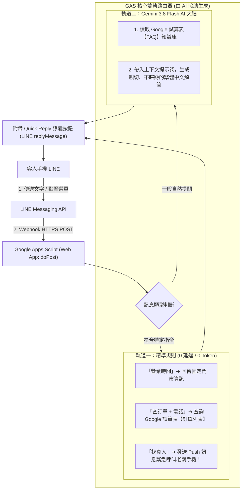

# 📘《零基礎用 AI 打造 LINE 智慧雙軌客服機器人》完整教學手冊與教案
### —— Google Sheets × Google Apps Script × Gemini Antigravity AI 協同開發

> **課程理念**：
> 2026 年的小白學寫程式，**不需要死記任何語法、不需要抓錯漏掉的分號**！
> 透過 **Google Gemini / Antigravity AI** 作為個人專屬程式助教，學員只需學習「系統架構思維」與「精準下指令 (Prompting)」，就能在 6 小時內親手打造一隻**能自動查試算表、懂專業 FAQ 客服、帶有底部快捷膠囊選單、還能即時呼叫店長手機**的企業級 LINE AI 機器人！

---

## 🧭 課程全景架構圖 (雙軌架構)



---

## ⏱️ 6 小時單日工作坊 / 4 週課程進度規劃

| 階段 | 單元名稱 | 核心能力指標 | 包含之 Antigravity AI 指令 |
| :---: | :--- | :--- | :--- |
| **09:30 - 11:00**<br>(1.5h) | **單元 1：身分建立與通訊骨幹**<br>認識 Webhook 與第一隻鸚鵡機器人 | 申請 LINE 官方帳號、取得憑證、部署 GAS Web App | 🗣️ 指令 1：生成基礎通訊與加好友歡迎詞 |
| **11:00 - 12:30**<br>(1.5h) | **單元 2：資料庫連動與點擊式選單**<br>試算表查單 + 快捷膠囊按鈕 (Quick Reply) | Google Sheets 當資料庫、設計圓角膠囊按鈕免打字 | 🗣️ 指令 2：生成試算表比對與 Quick Reply 代碼 |
| **12:30 - 13:30** | 🥪 **午休交流時間** | - | - |
| **13:30 - 15:00**<br>(1.5h) | **單元 3：插上 Gemini 3.8 Flash 智慧晶片**<br>動態試算表 FAQ 知識庫注入 | 取得 Gemini API Key、設計 System Prompt 防瞎掰 | 🗣️ 指令 3：串接 Gemini 並動態注入試算表知識庫 |
| **15:00 - 16:30**<br>(1.5h) | **單元 4：真人轉接、一鍵除錯與成果發表**<br>老闆手機即時推播 + 專題結業展示 | 實作 Push 警報、向 AI 描述錯誤一鍵修復 | 🗣️ 指令 4：人機協同推播與常見錯誤診斷 |

---

## 🛠️ 各單元極詳細教學步驟與 Antigravity 指令指南

---

### 【單元 1】身分建立與通訊骨幹 —— 打造你的第一隻 LINE Bot

#### 🎯 單元目標：
讓每位學員用自己的手機，完成第一次「我傳一句話、LINE 機器人照抄回傳一句話」。

#### 講師引導步驟：
1. **申請 LINE 官方身分（零程式碼，點按鈕）**：
   * 前往 [LINE Developers Console](https://developers.line.biz/) ➔ 點「Create a new provider」輸入自己的英文名字。
   * 點「Create a Messaging API channel」➔ 填寫機器人名稱（如：`OO生活智慧小幫手`）、上傳一張大頭貼。
   * 進入 Channel ➔ 切換至「Messaging API」分頁最下方 ➔ 點擊 **Issue** 產生長效 `Channel access token`。
   * 切換至「Basic settings」分頁最下方 ➔ 找到 **Your user ID**（以 `U` 開頭的 33 碼）。
   * **關鍵動作**：拿出手機，掃描畫面上的 QR Code，**把你的官方帳號加為好友**！
2. **開啟 Google 雲端編輯器**：
   * 進入 [Google 雲端硬碟](https://drive.google.com/) ➔ 新增一個 Google 試算表（命名為：`LINE智慧客服系統`）。
   * 點選上方選單 **「擴充功能」 ➔ 「Apps Script」**。

#### 🗣️ 學員對 Gemini / Antigravity 下的第一個指令：
> 📋 **學員請直接複製以下提示詞貼給 Antigravity：**
> ```text
> 我是一個完全不會寫程式的初學者，正在用 Google Apps Script 開發我的第一隻 LINE Bot。
> 我已經取得了 LINE 的 Channel Access Token。
> 請幫我寫一段最簡單的 doPost(e) 程式碼，具備以下兩個功能：
> 1. 當客人一加我的機器人為好友時，自動回覆：「🎉 歡迎加入！我是您的智慧助手，請隨意跟我聊聊～」
> 2. 當客人傳送任何文字時，機器人要像鸚鵡一樣照抄回傳他的文字。
> 請在程式碼中把需要填 Token 的地方清楚標示，並為每一行加上容易懂的繁體中文註解！
> ```

#### 機器人回覆與部屬指引：
學員將 AI 產生的程式碼貼入 Apps Script 後，講師指導點擊右上角：
👉 **「部署」 ➔ 「新增部署作業」 ➔ 齒輪選「網頁應用程式 (Web app)」 ➔ 誰可以存取選「所有人 (Anyone)」 ➔ 點「部署」**。
複製產生的 `https://script.google.com/.../exec` 網址填回 LINE Developers 的 Webhook URL，點 Verify 驗證！

---

### 【單元 2】資料庫連動與點擊式選單 —— 不用打字的「查訂單」

#### 🎯 單元目標：
讓學員體會「原來 Google 試算表就是後台資料庫」，並學會讓對話框下方長出圓角膠囊按鈕，手指一按就自動查單。

#### 講師引導步驟：
1. **建立資料庫工作表**：
   * 在 Google 試算表中，建立一張工作表命名為 **`訂單列表`**。
   * 第一列建立表頭：`下單時間 | 姓名 | 電話 | 商品 | 數量 | 狀態`。
   * 隨便填入 2 筆假資料（例如：電話 `0912-345-678`、狀態 `已出貨，預計明日送達`）。

#### 🗣️ 學員對 Gemini / Antigravity 下的第二個指令：
> 📋 **學員請直接複製以下提示詞貼給 Antigravity：**
> ```text
> 我正在用 Google Apps Script 開發 LINE 機器人。
> 我的試算表裡有一張名為「訂單列表」的工作表，欄位有「下單時間、姓名、電話、商品、數量、狀態」。
> 請幫我升級程式碼，加入以下功能：
> 1. 當客人點選或輸入「營業時間」時，回傳固定門市時間（週一至週五 09:00 - 18:00）。
> 2. 當客人點選或輸入「查訂單」時，請機器人親切提示：「請輸入手機號碼，我立刻幫您查試算表！」
> 3. 當客人輸入包含手機號碼（數字）時，自動去「訂單列表」工作表搜尋該電話，並回覆該客人的商品名稱與目前進度。
> 4. 最重要的一點：每次回覆客人的訊息下方，必須隨附「快捷膠囊按鈕 (Quick Reply)」，包含【📦 查詢訂單】、【⏰ 營業時間】、【👤 找真人】三顆按鈕，讓客人手指點一下就能直接選！
> 請給我完整的 Google Apps Script 程式碼！
> ```

#### 學員驚喜驗收點：
學員將 AI 升級後的代碼貼上並發布新版本。拿起手機對 LINE 說「營業時間」，下方立刻浮出 3 顆圓角膠囊按鈕！點一下「查詢訂單」，再輸入自己的電話號碼，試算表裡的狀態瞬間回傳到手機上！

---

### 【單元 3】接入 Gemini 3.8 Flash —— 動態 FAQ 智慧客服店長

#### 🎯 單元目標：
讓機器人擁有像真人一般的應答智商。最重要的是：**學會用 Google 試算表當知識庫，客人隨便怎麼問，AI 都不會瞎掰！**

#### 講師引導步驟：
1. **建立知識庫工作表**：
   * 在試算表新增一張工作表，命名為 **`FAQ`**。
   * A 欄寫 `問題`（例如：運費怎麼算？有賣耳機嗎？有鑑賞期嗎？）。
   * B 欄寫 `標準答案`（例如：全館滿千免運、耳機售價 3,200 元、享 7 天鑑賞期）。
2. **取得免費 Gemini API Key**：
   * 前往 [Google AI Studio](https://aistudio.google.com/apikey) ➔ 點「Create API key」複製金鑰。

#### 🗣️ 學員對 Gemini / Antigravity 下的第三個指令：
> 📋 **學員請直接複製以下提示詞貼給 Antigravity：**
> ```text
> 我希望在我的 Google Apps Script LINE 機器人中接入 Gemini 3.8 Flash 模型。
> 我希望這隻 AI 扮演「專業親切的官方店長」，並遵守以下嚴格規則：
> 1. 當客人提出的問題沒有命中「營業時間」或「查訂單」時，才交由 Gemini 智慧解答。
> 2. 請在呼叫 Gemini 之前，自動去我的 Google 試算表讀取「FAQ」工作表的內容，並將整張表格的問答當作知識庫注入給 Gemini。
> 3. 設定 System Instruction 約束 AI：必須用客氣親切的「繁體中文」作答，並且只能根據 FAQ 知識庫的內容回答；若知識庫未提及，絕不瞎掰，請引導客人點選下方按鈕轉接真人。
> 4. 回傳給客人的 AI 訊息下方，同樣要保留 Quick Reply 快捷膠囊按鈕！
> 請幫我整合進現有的 doPost 程式碼中！
> ```

#### 學員驚喜驗收點：
學員在 LINE 聊天室故意換句話問：「寄到台東要收運費嗎？」
AI 秒回：「您好！我們全館消費滿 1,000 元即享免運費喔！未滿額宅配為 100 元，超商為 60 元～😊」
學員當場見證：**只要在試算表多打一列商品，AI 就不必重新訓練、立刻能倒背如流！**

---

### 【單元 4】真人轉接、一鍵除錯與成果發表

#### 🎯 單元目標：
當 AI 無法解決客人的刁鑽問題時，客人一按「找真人」，老闆手機立刻「叮咚」收到警報！學員並學會如何用 AI 排除各種常見錯誤。

#### 講師引導步驟：
1. **理解 Push Message（老闆警報專線）**：
   * 機器人平時對客人講話用 `replyToken`（免錢、免記收件人）。
   * 但要通知老闆，必須主動打電話給老闆的 `Your user ID`（推播 Push）。

#### 🗣️ 學員對 Gemini / Antigravity 下的第四個指令：
> 📋 **學員請直接複製以下提示詞貼給 Antigravity：**
> ```text
> 請幫我在目前的 LINE 機器人程式中加入「真人客服緊急推播」功能：
> 1. 當客人點選或輸入「找真人」或「真人客服」時：
>    - 機器人先在聊天室回覆客人：「🛎️ 已為您發送緊急推播給值班店長，店長稍後將親自於本對話框為您服務，請您稍候！」
>    - 同時，程式必須利用 LINE 的 Push Message API，將這筆警報直接推播到老闆的手機 LINE（填入 BOSS_USER_ID）。
>    - 推播內容要包含：客人的 LINE User ID、最後說的話、呼叫時間。
> 2. 為了保護資安，請幫我把 LINE_ACCESS_TOKEN、BOSS_USER_ID、GEMINI_API_KEY 改為使用 PropertiesService.getScriptProperties() 讀取。
> 請給我完整的最終版程式碼！
> ```

---

## 🆘 課堂除錯神仙錦囊（學員遇到報錯時怎麼問 AI？）

小白在課堂上最容易遇到環境設定問題，講師請學員把遇到的錯誤直接複製，用以下提詞問 Antigravity：

### 情況 1：在 LINE Developers 點 Verify 出現「302 Error」
> **提詞範本**：
> 「我在 LINE Developers 設定 Webhook URL 時，點擊 Verify 出現『HTTP 302 ERROR_STATUS_CODE』。但我使用的是 Google Apps Script，請問這是什麼原因？我該如何修改 doPost 的 return 方式，或者這是正常的重新導向嗎？」

### 情況 2：客人傳訊息機器人完全沒回覆
> **提詞範本**：
> 「我的 LINE 機器人完全沒有回應客人訊息。我有取得 Channel Access Token，也有部署 GAS Web App。請幫我列出前 3 個最可能出錯的檢查清單（例如：LINE 後台回應模式、GAS 存取權限是否為所有人、Webhook 是否開啟？），並教我怎麼看 GAS 的執行記錄 (Executions) 來抓出錯誤？」

### 情況 3：呼叫 Gemini API 出現「402 Prepayment credits depleted」
> **提詞範本**：
> 「我的 Google Apps Script 在呼叫 Gemini API 時跳出錯誤：『HTTP 402: Your prepayment credits are depleted』。但我剛在 Google AI Studio 申請金鑰，請問為什麼會這樣？我該如何在 AI Studio 切換或儲值基本額度來解鎖？」

---

## 🏆 學員結業成果檢核清單 (Capstone Checklist)

每位學員下課時，需在自己手機上展示給講師確認：
- [ ] **身分開通**：擁有自己的 LINE 官方帳號與大頭貼。
- [ ] **試算表後台**：包含 `訂單列表` 與 `FAQ` 兩張試算表。
- [ ] **膠囊按鈕**：聊天室下方隨時浮現 `[ 📦 查詢訂單 ]`、`[ ⏰ 營業時間 ]`、`[ ❓ 常見問題 ]`、`[ 👤 轉接真人 ]`。
- [ ] **精準查單**：輸入號碼，機器人能從試算表撈出最新物流進度。
- [ ] **AI 智慧應答**：隨意詢問試算表裡記載的規則，Gemini 能以客氣繁中流暢回答。
- [ ] **老闆即時推播**：點擊「轉接真人」，老闆本人手機 LINE 真的響起叮咚警報！
