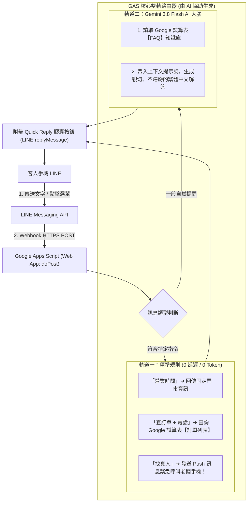
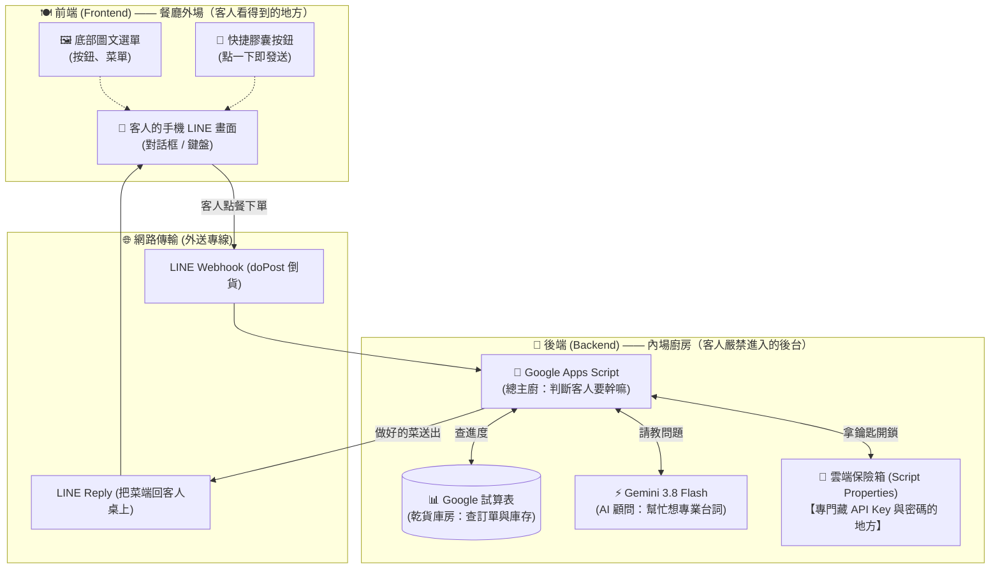
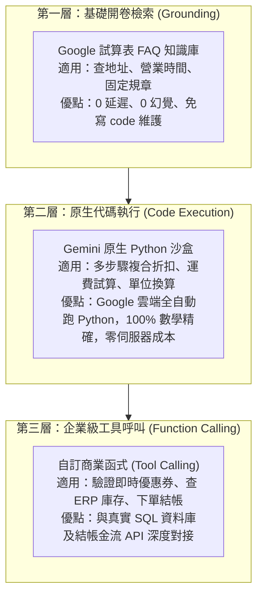

# 📘《零基礎用 AI 打造 LINE 智慧雙軌客服機器人》完整教學手冊與教案
### —— Google Sheets × Google Apps Script × Gemini Antigravity AI 協同開發

> **課程理念**：
> 2026 年的小白學寫程式，**不需要死記任何語法、不需要抓錯漏掉的分號**！
> 透過 **Google Gemini / Antigravity AI** 作為個人專屬程式助教，學員只需學習「系統架構思維」與「精準下指令 (Prompting)」，就能在 6 小時內親手打造一隻**能自動查試算表、懂專業 FAQ 客服、帶有底部快捷膠囊選單、還能即時呼叫店長手機**的企業級 LINE AI 機器人！

---

## 🧭 課程全景架構圖 (雙軌架構)



---

## ⏱️ 6 小時單日工作坊 / 4 週課程進度規劃

| 階段 | 單元名稱 | 核心能力指標 | 包含之 Antigravity AI 指令 |
| :---: | :--- | :--- | :--- |
| **09:30 - 11:00**<br>(1.5h) | **單元 1：身分建立與通訊骨幹**<br>認識 Webhook 與第一隻鸚鵡機器人 | 申請 LINE 官方帳號、取得憑證、部署 GAS Web App | 🗣️ 指令 1：生成基礎通訊與加好友歡迎詞 |
| **11:00 - 12:30**<br>(1.5h) | **單元 2：資料庫連動與點擊式選單**<br>試算表查單 + 快捷膠囊按鈕 (Quick Reply) | Google Sheets 當資料庫、設計圓角膠囊按鈕免打字 | 🗣️ 指令 2：生成試算表比對與 Quick Reply 代碼 |
| **12:30 - 13:30** | 🥪 **午休交流時間** | - | - |
| **13:30 - 15:00**<br>(1.5h) | **單元 3：插上 Gemini 3.8 Flash 智慧晶片**<br>動態試算表 FAQ 知識庫注入 | 取得 Gemini API Key、設計 System Prompt 防瞎掰 | 🗣️ 指令 3：串接 Gemini 並動態注入試算表知識庫 |
| **15:00 - 16:30**<br>(1.5h) | **單元 4：真人轉接、一鍵除錯與成果發表**<br>老闆手機即時推播 + 專題結業展示 | 實作 Push 警報、向 AI 描述錯誤一鍵修復 | 🗣️ 指令 4：人機協同推播與常見錯誤診斷 |

---

## 🛠️ 各單元極詳細教學步驟與 Antigravity 指令指南

---

### 【單元 1】身分建立與通訊骨幹 —— 打造你的第一隻 LINE Bot

#### 🎯 單元目標：
讓每位學員用自己的手機，完成第一次「我傳一句話、LINE 機器人照抄回傳一句話」。

#### 講師引導步驟：
1. **申請 LINE 官方身分（零程式碼，點按鈕）**：
   * 前往 [LINE Developers Console](https://developers.line.biz/) ➔ 點「Create a new provider」輸入自己的英文名字。
   * 點「Create a Messaging API channel」➔ 填寫機器人名稱（如：`OO生活智慧小幫手`）、上傳一張大頭貼。
   * 進入 Channel ➔ 切換至「Messaging API」分頁最下方 ➔ 點擊 **Issue** 產生長效 `Channel access token`。
   * 切換至「Basic settings」分頁最下方 ➔ 找到 **Your user ID**（以 `U` 開頭的 33 碼）。
   * **關鍵動作**：拿出手機，掃描畫面上的 QR Code，**把你的官方帳號加為好友**！
2. **開啟 Google 雲端編輯器**：
   * 進入 [Google 雲端硬碟](https://drive.google.com/) ➔ 新增一個 Google 試算表（命名為：`LINE智慧客服系統`）。
   * 點選上方選單 **「擴充功能」 ➔ 「Apps Script」**。

---

#### 🏛️ 小白通識第二彈：什麼是「前端」與「後端」？為什麼 API Key 一定要藏在後端？

很多初學者常聽到工程師聊「前端、後端、API Key」，聽得一頭霧水。其實只要用**「餐廳外場與內場廚房」**來想，就完全通了！

##### 1. 餐廳架構圖（前端 vs 後端）



##### 2. 前端與後端的分工
| 角色 | 現實比喻 | 在我們的 LINE Bot 系統裡是誰？ | 核心職責 |
| :--- | :--- | :--- | :--- |
| **前端 (Frontend)** | **餐廳外場與餐桌** | 客人手機上的 **LINE 聊天畫面**、**圖文選單**、**膠囊按鈕** | 負責「**長得好看**」與「**接收客人的點擊與輸入**」，把客人的需求傳遞給後台。 |
| **後端 (Backend)** | **內場廚房與金庫** | **Google Apps Script** + **Google 試算表資料庫** | 負責「**大腦運算**」，判斷客人的問題、查試算表、問 Gemini，並把做好的回答送回外場。 |

---

##### 3. 駭客危機：為什麼 API Key 絕對不能放在前端？怎麼藏？

> 🔑 **API Key 是什麼？**  
> 它就像你個人的**「信用卡」**或**「保險庫大門鑰匙」**。任何拿到這把 Key 的人，都可以拿去狂打 AI 模型，產生的費用全由你買單！

* **危險做法（放在前端）**：
  * 如果把 API Key 寫在網頁或前端 APP 上，任何只要懂按滑鼠右鍵「檢查原始碼」的壞人，**就能 1 秒抄走你的 Key 去盜刷**，直到你的錢包見底！
* **安全做法（藏在後端保險箱）**：
  * **金鑰永遠只能放在後端廚房（GAS 內部）**，客人永遠只能看到菜（文字回覆），永遠摸不到後台的廚具與金鑰。

##### 4. 在 Google Apps Script 裡，我們怎麼「藏」Key？
我們不要把金鑰直接寫在 code 的文字裡，而是使用 Google 內建的秘密夾層：  
👉 **【指令碼屬性 (Script Properties)】**！

```
【程式碼 (Code.gs)】
  只有一句指令：「去後台保險箱把 GEMINI_API_KEY 拿出來用！」
                     │
                     ▼ (安全讀取)
【Google 雲端保險箱 (Script Properties)】
  裡面鎖著真正的私密金鑰：AQ.Ab8RN6KugM8HEJKu04...
```

* **成果**：  
  就算你在投影幕前把整份程式碼展示給所有學生看，學生也只會看到 `SCRIPT_PROPS.getProperty(...)` 這行指令，**你的真實金鑰完完全全被鎖在 Google 安全保險箱內，100% 不會外洩！**

---

#### 💡 小白觀念大補帖：什麼是 doGet 和 doPost？那個 (e) 到底是什麼？

很多初學者第一次看到 `doPost(e)` 都會好奇：「為什麼一定要叫這個名字？不能叫 `main` 嗎？那個括號裡面的 `(e)` 是什麼意思？」

##### 1. 生活化比喻：看公佈欄 (GET) vs 投遞包裹信箱 (POST)
* **`doGet(e)` ➔ 「取得 (GET)」＝ 打開網頁看公佈欄**
  * 當你在瀏覽器網址列貼上 URL 按下 Enter 時，你的電腦是在向 Google 伺服器要求：「*請把這個網頁**拿 (GET)** 給我看！*」
  * 伺服器觸發的就是 `doGet(e)`，專門用來**顯示網頁畫面**或**檢查伺服器有沒有在運作**。
* **`doPost(e)` ➔ 「寄送 (POST)」＝ 快遞投遞包裹信箱**
  * 當客人在手機 LINE 上傳了一句話（例如：「有賣耳機嗎」），LINE 的伺服器會把這句話包裝成一個「快遞包裹」，**主動寄送 (POST)** 到你的 Google 網址。
  * 伺服器觸發的就是 `doPost(e)`，專門用來**接收外部主動送進來的資料**。
  * 💡 **這就是為什麼 LINE Bot 必須寫 `doPost`，因為 LINE 永遠是在向你的伺服器「寄送包裹」！**

##### 2. 那個括號裡的 `(e)` 是什麼？
* `e` 就是 **Event（事件快遞箱）**！它是 Google 收到外部連線時，自動塞給你的包裹箱。
* **最關鍵的一行：`JSON.parse(e.postData.contents)`**：
  * `e` = 快遞箱。
  * `e.postData` = 箱子裡的貨物資訊。
  * `e.postData.contents` = 撕開包裝紙看到的「真正內容物」（包含客人的 User ID、講的文字內容、一次性回覆的 replyToken）。

##### 3. 小白新手村最常問的經典迷思 ⚠️
> **「老師！我把部署好的 Web App 網址貼到瀏覽器打開，為什麼跳出錯誤說：`腳本函式找不到：doGet`？」**
* **解答**：因為你在瀏覽器網址列按 Enter 是發送 **GET** 請求，但程式如果只寫了專門收 LINE 包裹的 `doPost`，Google 找不到 `doGet` 當然會抗議！
* **最佳實務解法**：在程式裡順手加一個極簡的 `doGet`，這樣在瀏覽器點開網址時就會顯示漂亮的「🟢 系統運作中！」，而不是跳錯誤！

---

#### 🗣️ 學員對 Gemini / Antigravity 下的第一個指令：
> 📋 **學員請直接複製以下提示詞貼給 Antigravity：**
> ```text
> 我是一個完全不會寫程式的初學者，正在用 Google Apps Script 開發我的第一隻 LINE Bot。
> 我已經取得了 LINE 的 Channel Access Token。
> 請幫我寫一段最簡單的 doPost(e) 程式碼，具備以下兩個功能：
> 1. 當客人一加我的機器人為好友時，自動回覆：「🎉 歡迎加入！我是您的智慧助手，請隨意跟我聊聊～」
> 2. 當客人傳送任何文字時，機器人要像鸚鵡一樣照抄回傳他的文字。
> 請在程式碼中把需要填 Token 的地方清楚標示，並為每一行加上容易懂的繁體中文註解！
> ```

#### 機器人回覆與部屬指引：
學員將 AI 產生的程式碼貼入 Apps Script 後，講師指導點擊右上角：
👉 **「部署」 ➔ 「新增部署作業」 ➔ 齒輪選「網頁應用程式 (Web app)」 ➔ 誰可以存取選「所有人 (Anyone)」 ➔ 點「部署」**。
複製產生的 `https://script.google.com/.../exec` 網址填回 LINE Developers 的 Webhook URL，點 Verify 驗證！

---

### 【單元 2】資料庫連動與點擊式選單 —— 不用打字的「查訂單」

#### 🎯 單元目標：
讓學員體會「原來 Google 試算表就是後台資料庫」，並學會讓對話框下方長出圓角膠囊按鈕，手指一按就自動查單。

#### 講師引導步驟：
1. **建立資料庫工作表**：
   * 在 Google 試算表中，建立一張工作表命名為 **`訂單列表`**。
   * 第一列建立表頭：`下單時間 | 姓名 | 電話 | 商品 | 數量 | 狀態`。
   * 隨便填入 2 筆假資料（例如：電話 `0912-345-678`、狀態 `已出貨，預計明日送達`）。

#### 🗣️ 學員對 Gemini / Antigravity 下的第二個指令：
> 📋 **學員請直接複製以下提示詞貼給 Antigravity：**
> ```text
> 我正在用 Google Apps Script 開發 LINE 機器人。
> 我的試算表裡有一張名為「訂單列表」的工作表，欄位有「下單時間、姓名、電話、商品、數量、狀態」。
> 請幫我升級程式碼，加入以下功能：
> 1. 當客人點選或輸入「營業時間」時，回傳固定門市時間（週一至週五 09:00 - 18:00）。
> 2. 當客人點選或輸入「查訂單」時，請機器人親切提示：「請輸入手機號碼，我立刻幫您查試算表！」
> 3. 當客人輸入包含手機號碼（數字）時，自動去「訂單列表」工作表搜尋該電話，並回覆該客人的商品名稱與目前進度。
> 4. 最重要的一點：每次回覆客人的訊息下方，必須隨附「快捷膠囊按鈕 (Quick Reply)」，包含【📦 查詢訂單】、【⏰ 營業時間】、【👤 找真人】三顆按鈕，讓客人手指點一下就能直接選！
> 請給我完整的 Google Apps Script 程式碼！
> ```

#### 學員驚喜驗收點：
學員將 AI 升級後的代碼貼上並發布新版本。拿起手機對 LINE 說「營業時間」，下方立刻浮出 3 顆圓角膠囊按鈕！點一下「查詢訂單」，再輸入自己的電話號碼，試算表裡的狀態瞬間回傳到手機上！

---

### 【單元 3】接入 Gemini 3.8 Flash —— 動態 FAQ 試算表知識庫大腦

#### 🎯 單元目標：
讓機器人擁有像真人一般的應答智商。最關鍵核心概念：**學會用 Google 試算表當「動態知識庫 (Knowledge Base)」，客人隨便怎麼問，AI 都能根據官方資料親切回答，絕不胡言亂語（防幻覺）！**

---

#### 🧠 核心剖析：我們為什麼用 Google 試算表建立知識庫？

傳統工程師做 AI 客服知識庫，需要架設：
> `文字切塊 (Chunking)` ➔ `向量編碼 (Embedding)` ➔ `向量資料庫 (Vector DB 如 Pinecone)` ➔ `語意檢索 (RAG Pipeline)`

這對中小企業、系辦助教、行銷人員與程式小白來說門檻極高，且每次修改內容都需要工程師維護。

**本課程採用的極簡創新架構：Google Sheet 動態上下文注入 (Dynamic Few-Shot Grounding)**：
1. **零門檻維護**：知識庫就是一張 Google 試算表（`FAQ` 工作表），任何人只要會打字就能天天更新。
2. **零延遲即時生效**：只要試算表新增一列「問與答」，下一秒客人向 LINE Bot 提問，AI 瞬間學會，**完全不需要重新訓練、也不用重新部署**！
3. **Google 試算表雙工作表架構**：

| 工作表名稱 | 角色定位 | 處理方式 | 範例欄位 |
| :--- | :--- | :--- | :--- |
| **`訂單列表`** | **交易資料庫 (Transactional DB)** | 純程式精準比對 (Exact Match)，零幻覺 | `下單時間`、`姓名`、`電話`、`商品`、`數量`、`狀態` |
| **`FAQ`** | **語意知識庫 (Knowledge Base)** | 注入 Gemini 3.8 Flash 提示詞，自然語言語意回答 | `主題 / 常見問題` (A欄)、`標準答案 / 規格介紹` (B欄) |

---

#### 📋 知識庫試算表範本（Google Sheet `FAQ` 工作表）

在 Google 試算表新增名為 **`FAQ`** 的工作表，填入以下範例：

| 主題 / 常見問題 (A欄) | 標準答案 / 規格介紹 (B欄) |
| :--- | :--- |
| **服務時間 / 營業時間** | 國立臺中科技大學 國貿系辦公室服務時間為：週一至週五 08:30 - 17:00（中午 12:00 - 13:00 休息），週六日及國定假日公休。AI智慧客服線上 24 小時為您服務！ |
| **地址 / 交通位置** | 台中市北區三民路三段129號（國立臺中科技大學 三民校區中正大樓 7 樓 3705 國貿系辦公室）。近中友百貨與一中商圈。 |
| **國貿系介紹 / 聯絡電話** | 國立臺中科技大學 國際貿易系，培育國際經貿、跨境電商與商務談判專業人才。系辦位於中正大樓 3705 室，電話：(04) 2219-6120。 |
| **商品清單** | 系所實習商品清單：1. 頂級主動降噪藍牙耳機（$3,200） 2. 復古機械鍵盤（$2,480） 3. 人體工學滑鼠（$1,350）。全館滿千免運！ |
| **運費政策** | 全館消費滿 1,000 元即享免運費，未滿額黑貓宅配運費為 100 元，超商取貨 60 元。 |
| **退換貨政策** | 所有商品皆享有 7 天鑑賞期，拆封若有非人為瑕疵均可免費退換新機。 |

---

#### 講師引導步驟：
1. **建立知識庫工作表**：
   * 在試算表新增一張工作表，工作表標籤名稱務必命名為 **`FAQ`**（注意全大寫、前後不能有空格）。
   * A 欄第 1 列寫 `主題 / 常見問題`，B 欄第 1 列寫 `標準答案 / 規格介紹`。
   * 第 2 列開始填寫常見問答。
2. **取得免費 Gemini API Key**：
   * 前往 [Google AI Studio](https://aistudio.google.com/apikey) ➔ 點「Create API key」複製金鑰。
3. **程式碼內部如何讀取並注入 (揭秘原理)**：
   ```javascript
   // 1. 抓取試算表 FAQ 分頁的所有資料
   const faqSheet = ss.getSheetByName("FAQ");
   let knowledge = "";
   const rows = faqSheet.getDataRange().getValues();
   for (let r = 1; r < rows.length; r++) {
     if (rows[r][0] && rows[r][1]) {
       knowledge += `問：${rows[r][0]}，答：${rows[r][1]}\n`;
     }
   }

   // 2. 注入 Gemini 的 System Instruction
   const systemPrompt = `你是國立臺中科技大學國際貿易系（國貿系）的官方 AI智慧客服。
   原則：
   1. 保持親切、專業、熱情，一律使用「繁體中文」。
   2. 官方位置：台中市北區三民路三段129號（三民校區中正大樓 7 樓 3705 系辦公室），電話 (04) 2219-6120。
   3. 介紹系所、服務時間、地址、課程活動或商品訂單時，請優先參考以下官方知識庫回答。
   4. 若知識庫未提及或超出範圍，請客氣告知並建議點選下方「轉接真人」由系辦助教/專人為您服務。
   【官方知識庫】：
   ${knowledge}`;
   ```

#### 🗣️ 學員對 Gemini / Antigravity 下的第三個指令：
> 📋 **學員請直接複製以下提示詞貼給 Antigravity：**
> ```text
> 我希望在我的 Google Apps Script LINE 機器人中接入 Gemini 3.8 Flash 模型。
> 我希望這隻 AI 扮演「國立臺中科技大學 國貿系 官方 AI智慧客服」，並遵守以下嚴格規則：
> 1. 當客人提出的問題沒有命中「營業時間」或「查訂單」時，才交由 Gemini 智慧解答。
> 2. 請在呼叫 Gemini 之前，自動去我的 Google 試算表讀取「FAQ」工作表的內容，並將整張表格的問答當作知識庫動態注入給 Gemini。
> 3. 設定 System Instruction 約束 AI：必須用客氣親切的「繁體中文」作答，並且只能根據 FAQ 知識庫的內容回答；若知識庫未提及，絕不瞎掰，請引導客人點選下方按鈕轉接真人。
> 4. 重要設定：在 generationConfig 中加入 thinkingConfig: { thinkingBudget: 0 } 並將 maxOutputTokens 設為 1500，確保 AI 不會因為內部思考而截斷句子。
> 5. 回傳給客人的 AI 訊息下方，同樣要保留 Quick Reply 快捷膠囊按鈕！
> 請幫我整合進現有的 doPost 程式碼中！
> ```

#### 學員驚喜驗收點：
學員在 LINE 聊天室故意換句話問：「寄到台東要收運費嗎？」或「系辦在幾樓？」
AI 秒回：「您好！系辦公室位於三民校區中正大樓 7 樓 3705 室喔！電話是 (04) 2219-6120～😊」
學員當場見證：**只要在試算表多打一列新資訊，AI 就不必重新訓練、立刻能倒背如流！**

---

### 【單元 4】真人轉接、一鍵除錯與成果發表

#### 🎯 單元目標：
當 AI 無法解決客人的刁鑽問題時，客人一按「找真人」，老闆手機立刻「叮咚」收到警報！學員並學會如何用 AI 排除各種常見錯誤。

#### 講師引導步驟：
1. **理解 Push Message（老闆警報專線）**：
   * 機器人平時對客人講話用 `replyToken`（免錢、免記收件人）。
   * 但要通知老闆，必須主動打電話給老闆的 `Your user ID`（推播 Push）。
2. **雲端保險箱 (Script Properties) 設定路徑**：
   * 在 Apps Script 畫面左側點選 ⚙️ **「專案設定 (Project Settings)」**。
   * 滾動到最下方找到 **「指令碼屬性 (Script Properties)」**。
   * 點擊「新增指令碼屬性」依序加入：
     - `LINE_ACCESS_TOKEN`：LINE 的長效權杖
     - `BOSS_USER_ID`：老闆自己的 LINE User ID (U 開頭)
     - `GEMINI_API_KEY`：Google AI Studio 產生的金鑰

#### 🗣️ 學員對 Gemini / Antigravity 下的第四個指令：
> 📋 **學員請直接複製以下提示詞貼給 Antigravity：**
> ```text
> 請幫我在目前的 LINE 機器人程式中加入「真人客服緊急推播」功能：
> 1. 當客人點選或輸入「找真人」或「真人客服」時：
>    - 機器人先在聊天室回覆客人：「🛎️ 已為您發送緊急推播給系辦專人！專人稍後將親自於本對話框為您服務，請您稍候片刻！」
>    - 同時，程式必須利用 LINE 的 Push Message API，將這筆警報直接推播到老闆的手機 LINE（填入 BOSS_USER_ID）。
>    - 推播內容要包含：客人的 LINE User ID、最後說的話、呼叫時間。
> 2. 為了保護資安，請幫我把 LINE_ACCESS_TOKEN、BOSS_USER_ID、GEMINI_API_KEY 改為使用 PropertiesService.getScriptProperties() 讀取。
> 請給我完整的最終版程式碼！
> ```

---

### 【單元 5（進階大師專題）】超越文字心算：Code Execution 與 Function Calling

#### 🎯 單元目標：
理解為什麼大語言模型「文字心算」容易出錯，並掌握現代 AI Agent 最頂級的兩種精準計算與外部連動架構：**Gemini 原生 Python 程式碼執行器 (Code Execution)** 與 **自訂函式呼叫 (Function Calling)**。

---

#### 🧠 核心觀念：AI 系統的三層演進階梯

當客人問出複雜多條件問題（例如：*「我買 2 台鍵盤打 85 折，再折 100 元折價券，如果寄澎湖離島加多少運費？總共多少？」*），傳統聊天機器人通常會胡亂心算出一個錯誤數字（幻覺）。

業界最強的現代 AI Agent 採用以下三層架構：



---

#### 🛠️ 實戰 1：開啟 Gemini 原生 Python 程式碼執行 (Code Execution)

Gemini 官方內建了強大的 Python 沙盒。在呼叫 API 時，只需在 payload 加入 `tools: [{ codeExecution: {} }]`：

```javascript
// 在 Google Apps Script 中啟用 Code Execution
const payload = {
  contents: [{ role: "user", parts: [{ text: userQuestion }] }],
  systemInstruction: { parts: [{ text: systemPrompt }] },
  // 👇 關鍵：開啟 Google 官方雲端 Python 沙盒
  tools: [
    { codeExecution: {} }
  ],
  generationConfig: {
    temperature: 0.2,
    maxOutputTokens: 1500
  }
};
```

* **運作機制**：
  1. Gemini 判斷這是一道算術題，它**不會自己猜數字**，而是在背後寫出一小段 Python 程式：
     ```python
     keyboard_price = 2480
     subtotal = keyboard_price * 2 * 0.85
     coupon = 100
     shipping_penghu = 220
     total = subtotal - coupon + shipping_penghu
     print(f"小計: {subtotal}, 總額: {total}")
     ```
  2. Google 雲端沙盒瞬間執行該 Python，回傳 `小計: 4216.0, 總額: 4336.0`。
  3. Gemini 依據精準執行結果回覆客人，**算術正確率 100%，徹底杜絕心算幻覺**！

---

#### 🛠️ 實戰 2：企業級自訂函式呼叫 (Function Calling)

如果折扣公式涉及公司的保密演算法，或需要即時連線資料庫驗證 VIP 身分：

1. **定義工具架構 (Tool Definition)**：
   ```javascript
   const tools = [{
     functionDeclarations: [{
       name: "calculateOrderQuote",
       description: "精準計算商品折扣、折價券與各地區運費總額",
       parameters: {
         type: "OBJECT",
         properties: {
           item: { type: "STRING", description: "商品名稱" },
           quantity: { type: "INTEGER", description: "購買數量" },
           discountRate: { type: "NUMBER", description: "折扣折數，例如 0.85" },
           couponDiscount: { type: "NUMBER", description: "折價券折抵金額" },
           destination: { type: "STRING", description: "寄送目的地，例如 澎湖、本島" }
         },
         required: ["item", "quantity", "destination"]
       }
     }]
   }];
   ```
2. **後端執行與回饋**：
   - Gemini 分析客人的自然語言，自動抽取出 JSON 參數。
   - 後端（GAS 或 Python）執行 `calculateOrderQuote()`，將精確結果回餵給 Gemini。
   - Gemini 轉換為有溫度的客服回話，呈現給客人！

---

---

## ⚡ 零基礎小白實戰 7 大隱形避坑指南 (Crucial Gotchas)

這 7 個坑是教學現場所累積出最常讓新手與講師卡關的細節，請學員務必詳讀：

### 🛑 坑 1：修改 GAS 程式碼後，手機測試永遠是舊版本？（版本鎖定問題）
* **【致命原因】**：Google Apps Script 的 Web App 部署是**「快照版本制 (Snapshot)」**！只按編輯器的「儲存 💾」按鈕，雲端執行的依舊是發布時的舊版本！
* **【錯誤操作】**：千萬不要每次都點「新增部署作業」，那樣會產生新的 URL，導致 LINE 的 Webhook 失效！
* **【唯一正確做法】**：
  1. 編輯器右上角點 **「部署」 ➔ 「管理部署作業」**。
  2. 點選左側現有的 Web App 部署 ➔ 點右上角 **「鉛筆圖示 (編輯)」**。
  3. 版本下拉選單選擇 **「新版本」** ➔ 點擊右下角 **「部署」**！
  4. 網址完全不變，程式碼 1 秒在全雲端生效！

### 🛑 坑 2：LINE Developers 後台點擊 Verify 出現「HTTP 302 錯誤」？
* **【致命原因】**：GAS Web App 的底層機制在收到請求時，會自動 302 重新導向至 `script.googleusercontent.com`。LINE Developers 介面上的「Verify 測試探針」不跟隨 302 轉址，因此回報紅字 `HTTP 302 ERROR_STATUS_CODE`。
* **【解惑心法】**：**看到 302 完全不需要害怕！這是正常現象！** LINE 實際傳送客人的即時訊息時，伺服器會 100% 正常跟隨 302 轉址處理。只要直接拿起手機傳訊息測試即可！

### 🛑 坑 3：LINE Developers 的「Use Webhook」開關忘記打開！
* **【致命原因】**：很多學員在 LINE Developers 貼上 Webhook URL 後就以為好了，卻沒注意網址下方有一顆 **「Use Webhook」開關**！如果沒有把它切換成開啟（綠色 Active），LINE 根本不會將訊息推送出來。

### 🛑 坑 4：LINE 官方後台預設罐頭訊息與機器人打架！
* **【致命原因】**：LINE 官方帳號管理後台 ([manager.line.biz](https://manager.line.biz/)) 預設開啟了「自動回應訊息」與「聊天室」模式。當客人傳訊息時，官方的預設機器人會搶著發「感謝您的來訊...」，造成一問兩答。
* **【解法】**：登入 LINE Official Account Manager ➔ 點右上角「設定」 ➔ 「回應設定」 ➔ 將回應模式設定為 **「Bot (聊天機器人)」**，並關閉「自動回應訊息」。

### 🛑 坑 5：Gemini 3.8 Flash 回話講到一半被切斷？（Thinking Budget 陷阱）
* **【致命原因】**：Gemini 3.8 Flash 最新模型預設啟用了「思考模式 (Extended Thinking)」，思考過程會消耗掉數百個 Output Token。如果設定的 `maxOutputTokens` 只有 400，AI 光是思考就吃掉 350 tokens，剩下 50 tokens 導致回覆只講了半句話就截斷！
* **【解法】**：在 API 呼叫參數中明確關閉 thinking，並加大 tokens 上限：
  ```javascript
  generationConfig: {
    temperature: 0.3,
    maxOutputTokens: 1500,
    thinkingConfig: { thinkingBudget: 0 } // 關閉內部思考，0延遲且不吃Token
  }
  ```

### 🛑 坑 6：試算表名稱大小寫或多了一個空格！
* **【致命原因】**：程式碼中寫 `ss.getSheetByName("FAQ")`，是大小寫敏感的精確比對。如果學員把工作表取名為 `faq`、`Faq`，或者手滑在後面多打了一個空格變成 `FAQ `，GAS 就會回傳 `null`，導致知識庫完全無法載入！
* **【解法】**：工作表標籤請嚴格命名為 `FAQ` 與 `訂單列表`，不要有任何多餘空格。

### 🛑 坑 7：測試「加好友歡迎訊息」卻完全沒動靜？
* **【致命原因】**：LINE 的 `follow` 事件只在「初次加入好友」或「解除封鎖」的那一瞬間觸發一次！如果測試者已經是好友，傳任何文字都不會再觸發歡迎訊息。
* **【解法】**：在手機 LINE 聊天室右上角選單點 **「封鎖」 ➔ 再點「解除封鎖」**，系統就會立刻重新觸發 `follow` 事件，彈出歡迎詞與 4 顆圓角膠囊按鈕！

---

## 🏆 學員結業成果檢核清單 (Capstone Checklist)

每位學員下課時，需在自己手機上展示給講師確認：
- [ ] **身分開通**：擁有自己的 LINE 官方帳號與大頭貼。
- [ ] **試算表後台**：包含 `訂單列表`（查單）與 `FAQ`（AI 知識庫）兩張工作表。
- [ ] **膠囊按鈕**：聊天室下方隨時浮現 `[ 📦 查詢訂單 ]`、`[ ⏰ 營業時間 ]`、`[ ❓ 常見問題 ]`、`[ 👤 轉接真人 ]`。
- [ ] **精準查單**：輸入號碼，機器人能從試算表撈出最新物流進度。
- [ ] **AI 智慧應答**：隨意詢問試算表裡記載的規則，Gemini 能以客氣繁中流暢回答，不瞎掰。
- [ ] **老闆即時推播**：點擊「轉接真人」，老闆本人手機 LINE 真的響起叮咚警報！
