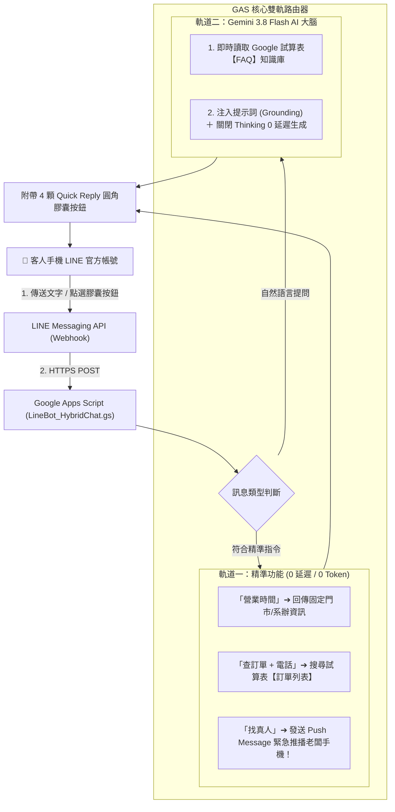

# 🚀 Google Apps Script × LINE 智慧雙軌客服 & 輕量 ERP 訂單通知系統
### Google Apps Script × LINE Messaging API × Gemini 3.8 Flash AI

<p align="center">
  <b>🌐 <a href="README.md">繁體中文</a> | <a href="README_EN.md">English</a></b>
</p>

> **專為零基礎學員、中小電商賣家、大專院校系所設計的無痛商業自動化與 AI 客服套件**  
> 支援「Google 表單下單 ➔ Google 試算表存檔 ➔ 老闆手機 LINE 即時叮咚通知」，並內建 **LINE 雙軌智慧客服系統**（快捷膠囊選單 Quick Reply ＋ Google 試算表查訂單 ＋ Gemini 3.8 Flash 動態知識庫 ＋ 真人緊急警報推播）！

---

## 🌟 核心特色

1. **零伺服器成本 (100% Serverless)**：
   * 後端完全運行在 Google 雲端（Google Apps Script + Google 試算表），24 小時在線、完全免費，無需本機開機。
2. **LINE 雙軌分流架構 (Dual-Track Architecture)**：
   * **軌道一（精準規則）**：查訂單（讀取試算表）、門市營業時間、呼叫真人客服，0 延遲、0 Token 費用、0% 幻覺。
   - **軌道二（Gemini 3.8 Flash）**：自然語言提問自動讀取 Google 試算表 `FAQ` 知識庫，以親切繁中作答，絕不瞎掰。
3. **底部快捷膠囊選單 (Quick Reply)**：
   * 每則回覆底部自動彈出 4 顆圓角膠囊按鈕（`📦 查詢訂單`、`⏰ 營業時間`、`❓ 常見問題`、`👤 轉接真人`），客人手指一按即可互動，省去打字麻煩。
4. **真人轉接緊急推播 (Human Handoff)**：
   * 客人點擊「找真人」時，後端自動透過 LINE Push Message API 將緊急警報直接發送到管理者私人手機！
5. **超越心算的現代 AI 架構 (Code Execution & Function Calling)**：
   * 支援開啟 Gemini 原生 Python 程式碼執行器，在雲端沙盒自動運算多重折扣與運費，徹底消除數字運算幻覺。
6. **完整防坑教學與教案手冊**：
   * 內附 6 小時「零基礎小白 AI 實戰工作坊」手冊 [COURSE_CURRICULUM.md](COURSE_CURRICULUM.md)，詳細解析 7 大實戰隱形避坑指南。

---

## 🏗️ 系統整體架構圖



---

## 📂 專案檔案結構清單

```text
├── README.md                         # 📘 繁體中文說明文件
├── README_EN.md                      # 🌐 English Documentation
├── COURSE_CURRICULUM.md              # 🎓 6 小時「零基礎小白 AI 實戰工作坊」超詳細教案手冊
├── SKILL.md                          # 🤖 Antigravity 專屬 Skill 定義檔
├── LineBot_HybridChat.gs             # 🚀 完整雙軌智慧客服核心腳本（Quick Reply + 試算表 + Gemini 3.8 + 真人推播）
├── GoogleSheet_LineOrderNotify.gs    # 📦 Google 表單/試算表 ➔ LINE 訂單即時推播核心腳本（18行）
├── app.py                            # 💻 本機線上商店下單測試伺服器（Port 8888）
├── test_line_push.py                 # 🔍 LINE Token 與 User ID 一鍵診斷測試工具
├── chatbot.py                        # 💬 Gemini 3.8 Flash 終端機對話機器人
├── chat.html                         # 🌐 Gemini 3.8 Flash 獨立網頁版聊天室
├── WebApp_Bot.gs                     # ☁️ 純 GAS 網頁版 AI 助理後端腳本
├── Code.gs                           # ⚙️ 進階 LINE 客服機器人備用腳本
└── appsscript.json                   # ⚙️ Google Apps Script 專案資訊設定
```

---

## 🚀 快速開始

### 模式 A：【雙軌 AI 客服機器人】（推薦）

1. **建立 Google 試算表**：
   * 建立兩張工作表：
     - `訂單列表`：欄位包含 `下單時間 | 姓名 | 電話 | 商品 | 數量 | 狀態`
     - `FAQ`：欄位包含 `主題 / 常見問題 (A欄) | 標準答案 / 規格介紹 (B欄)`
2. **貼入 Apps Script 程式碼**：
   * 點選試算表選單 **「擴充功能」 ➔ 「Apps Script」**。
   * 將 [LineBot_HybridChat.gs](LineBot_HybridChat.gs) 貼入。
3. **設定指令碼屬性 (Script Properties)**：
   * 在 Apps Script 左側齒輪「專案設定」最下方「指令碼屬性」填入：
     - `LINE_ACCESS_TOKEN`：LINE Developers 發行的 Channel Access Token
     - `BOSS_USER_ID`：老闆個人的 LINE User ID (`U` 開頭)
     - `GEMINI_API_KEY`：Google AI Studio 發行的金鑰
4. **發布 Web App**：
   * 右上角點擊 **「部署」 ➔ 「新增部署作業」 ➔ 齒輪選「網頁應用程式」**。
   * 誰可以存取選 **「所有人 (Anyone)」** ➔ 點擊部署。
   * 將獲得的 URL 填回 LINE Developers 的 **Webhook URL** 並開啟 **Use Webhook** 開關！

---

### 模式 B：【Google 表單 ➔ LINE 即時訂單推播】（40 分鐘搞定）

1. 前往 [Google 表單](https://forms.google.com/) 建立訂購單（姓名、電話、商品、數量、備註），點擊「回覆」連結至 Google 試算表。
2. 進入試算表 Apps Script，貼入 [GoogleSheet_LineOrderNotify.gs](GoogleSheet_LineOrderNotify.gs)，填入 Token 與 User ID。
3. Apps Script 左側點擊 ⏰ **「觸發條件」 ➔ 新增觸發條件**：
   * 執行功能：`onFormSubmit`
   * 活動來源：`來自試算表`
   * 活動類型：`提交表單時 (On form submit)`
4. 只要有客人填單，老闆手機立刻收到叮咚推播！

---

### 模式 C：【本機免環境 30 秒實測】

在終端機啟動本機測試商店：
```bash
python3 app.py
```
瀏覽器開啟 `http://localhost:8888`，填寫訂單送出，您的手機將在 1 秒內收到真實的 LINE 訂單推播通知！

---

## ⚡ 實戰必看的 7 大避坑指南 (Gotchas)

1. **版本鎖定坑**：GAS 修改程式碼後，必須走 **「部署 ➔ 管理部署作業 ➔ 編輯 ➔ 新版本 ➔ 部署」**，只按儲存線上完全不會生效！
2. **LINE Developers Use Webhook 開關**：填完 Webhook URL 後，務必手動開啟下方的「Use Webhook」開關。
3. **Verify 302 錯誤迷思**：LINE Developers 點 Verify 出現「HTTP 302」是 GAS 的正常轉址行為，直接用手機傳 LINE 測試即可。
4. **LINE 官方預設回應打架**：至 [manager.line.biz](https://manager.line.biz/) 將回應模式設為 **Bot**，並關閉預設「自動回應訊息」。
5. **Thinking Budget 截斷問題**：Gemini 3.8 Flash 務必在設定中加入 `thinkingConfig: { thinkingBudget: 0 }` 並設定 `maxOutputTokens: 1500`，避免 AI 思考吃光字數。
6. **試算表分頁名稱精確對齊**：`FAQ` 與 `訂單列表` 工作表名稱必須完全相符，嚴禁前後帶空格。
7. **加好友歡迎詞重複測試方法**：在手機 LINE 聊天室中將機器人「封鎖」後再「解除封鎖」，即可重新觸發加好友歡迎事件。

---

## 📜 授權條款 (License)

本專案採用 [MIT License](LICENSE) 授權，歡迎自由修改、教學講義使用與商業整合。
