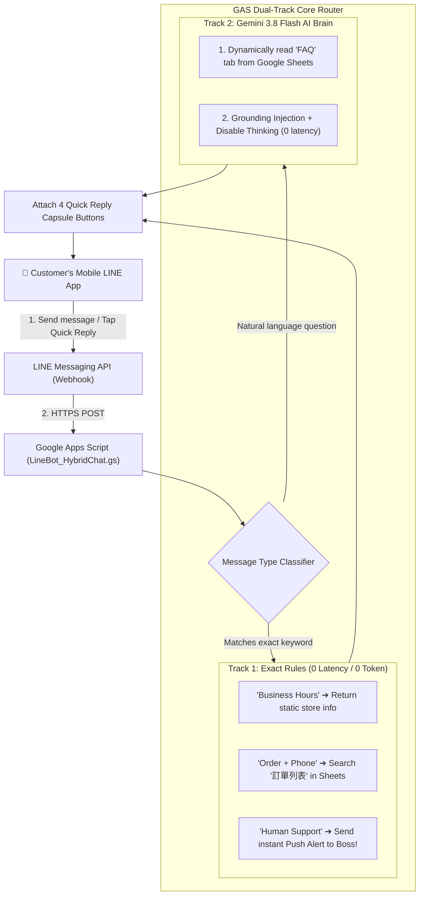

# 🚀 Google Apps Script × LINE Smart Dual-Track Customer Service & Lightweight ERP System
### Google Apps Script × LINE Messaging API × Gemini 3.8 Flash AI

<p align="center">
  <b>🌐 <a href="README.md">繁體中文</a> | <a href="README_EN.md">English</a></b>
</p>

> **A painless business automation and AI customer service kit designed for zero-code beginners, small-to-medium e-commerce merchants, and academic departments.**  
> Supports "Google Forms Order ➔ Google Sheets Storage ➔ Instant LINE Push Notification to Boss's Phone", and features a complete **LINE Dual-Track Smart Customer Service System** (Quick Reply buttons + Google Sheets order lookup + Gemini 3.8 Flash dynamic FAQ knowledge base + Human handoff emergency push alert)!

---

## 🌟 Key Features

1. **100% Serverless & Zero Server Cost**:
   * Fully powered by Google Cloud (Google Apps Script + Google Sheets). Runs 24/7 online for free without requiring a running computer.
2. **Dual-Track Message Router Architecture**:
   * **Track 1 (Deterministic Rules)**: Order lookup (reads Google Sheets directly), business hours, human handoff. 0 latency, 0 token cost, and 0% hallucination.
   * **Track 2 (Gemini 3.8 Flash Brain)**: Natural language queries dynamically retrieve knowledge from the Google Sheets `FAQ` tab. Responds with polite Traditional Chinese and adheres strictly to official data.
3. **Interactive Quick Reply Capsule Menu**:
   * Every bot reply is accompanied by 4 rounded capsule buttons (`📦 Order Lookup`, `⏰ Business Hours`, `❓ FAQ`, `👤 Human Support`), allowing users to tap rather than type.
4. **Human Handoff Instant Push Notification**:
   * When a customer requests human assistance, the backend uses the LINE Messaging API (`POST /v2/bot/message/push`) to send an instant alert directly to the manager's private LINE account.
5. **Beyond Mental Math: Modern AI Agent Architecture (Code Execution & Function Calling)**:
   * Supports Gemini's native Python Code Execution sandbox to compute multi-tiered discounts and shipping rates, completely eliminating numerical calculation hallucinations.
6. **Comprehensive Workshop Handbook & Troubleshooting Guide**:
   * Includes the full 6-hour beginner AI workshop syllabus [COURSE_CURRICULUM.md](COURSE_CURRICULUM.md), with detailed explanations of the 7 most common deployment gotchas.

---

## 🏗️ System Architecture



---

## 📂 Repository File Structure

```text
├── README.md                         # 📘 Traditional Chinese Documentation
├── README_EN.md                      # 🌐 English Documentation
├── COURSE_CURRICULUM.md              # 🎓 6-Hour Beginner AI Workshop Syllabus & Prompts
├── SKILL.md                          # 🤖 Antigravity Custom Skill Definition
├── LineBot_HybridChat.gs             # 🚀 Dual-Track LINE Bot core script (Quick Reply + Sheets + Gemini + Push)
├── GoogleSheet_LineOrderNotify.gs    # 📦 Google Forms/Sheets ➔ Instant LINE Push script (18 lines)
├── app.py                            # 💻 Local e-commerce store demo server (Port 8888)
├── test_line_push.py                 # 🔍 One-click LINE Token & User ID diagnostic tool
├── chatbot.py                        # 💬 Gemini 3.8 Flash CLI chat script
├── chat.html                         # 🌐 Standalone Gemini 3.8 Flash web chatroom
├── WebApp_Bot.gs                     # ☁️ Pure GAS Web App AI backend script
├── Code.gs                           # ⚙️ Advanced LINE customer service fallback script
└── appsscript.json                   # ⚙️ Google Apps Script project manifest
```

---

## 🚀 Quick Start Guide

### Mode A: Dual-Track AI Customer Service Bot (Recommended)

1. **Set Up Google Sheets**:
   * Create two tabs:
     - `訂單列表` (Order List): Columns `Timestamp | Name | Phone | Product | Quantity | Status`
     - `FAQ` (Knowledge Base): Columns `Topic / Question (Col A) | Standard Answer (Col B)`
2. **Paste Apps Script Code**:
   * In your Google Sheet, navigate to **Extensions ➔ Apps Script**.
   * Copy and paste the contents of [LineBot_HybridChat.gs](LineBot_HybridChat.gs).
3. **Configure Script Properties**:
   * Click **Project Settings (Gear Icon)** in the left sidebar, scroll down to **Script Properties**, and add:
     - `LINE_ACCESS_TOKEN`: Your Channel Access Token from LINE Developers Console.
     - `BOSS_USER_ID`: The recipient's LINE User ID (starts with `U`).
     - `GEMINI_API_KEY`: API Key from Google AI Studio.
4. **Deploy Web App**:
   * Click **Deploy ➔ New Deployment ➔ Select type: Web app**.
   * Set **Execute as**: `Me` and **Who has access**: `Anyone`.
   * Click **Deploy**, copy the Web App URL, paste it into LINE Developers Console as the **Webhook URL**, and toggle **Use Webhook** ON!

---

### Mode B: Google Forms ➔ Instant LINE Order Push Notification (40 Minutes)

1. Create a Google Form (Name, Phone, Product, Quantity, Note) and link responses to a Google Sheet.
2. In the Google Sheet, open Apps Script and paste [GoogleSheet_LineOrderNotify.gs](GoogleSheet_LineOrderNotify.gs), entering your Token and User ID.
3. In Apps Script, click ⏰ **Triggers ➔ Add Trigger**:
   * Choose function: `onFormSubmit`
   * Event source: `From spreadsheet`
   * Event type: `On form submit`
4. Whenever a customer submits the form, the manager's phone receives an instant LINE chime notification!

---

### Mode C: Instant Local 30-Second Test

Start the local mock shop server from your terminal:
```bash
python3 app.py
```
Open `http://localhost:8888` in your browser. Click **"Confirm Order"**, and your phone will receive a live LINE push notification within 1 second!

---

## ⚡ Crucial Deployment Gotchas & Tips

1. **GAS Version Locking**: After modifying code in Google Apps Script, you MUST go to **Deploy ➔ Manage Deployments ➔ Edit (Pencil) ➔ Version: New Version ➔ Deploy**. Merely clicking "Save" does NOT update the live cloud Web App!
2. **LINE Developers "Use Webhook" Switch**: After entering the Webhook URL, remember to toggle the "Use Webhook" switch below the URL to active (green).
3. **HTTP 302 on LINE Verify**: Clicking the "Verify" button in LINE Developers Console returns `HTTP 302 ERROR_STATUS_CODE`. This is normal behavior because GAS redirects requests to `googleusercontent.com`. LINE's live messaging pipeline follows 302 redirects properly; verify by texting the bot directly on mobile!
4. **Disable LINE Auto-Response Collision**: Log in to [manager.line.biz](https://manager.line.biz/) ➔ Settings ➔ Response settings. Set the Response mode to **Bot** and turn OFF "Auto-response messages" so they don't collide with the webhook.
5. **Thinking Budget Truncation in Gemini 3.8 Flash**: Always configure `thinkingConfig: { thinkingBudget: 0 }` and increase `maxOutputTokens: 1500` to prevent the model's internal thinking process from consuming token quota and cutting off responses mid-sentence.
6. **Sheet Tab Case Sensitivity**: Tab names `FAQ` and `訂單列表` are strictly case-sensitive. Ensure there are no leading or trailing whitespace characters.
7. **Retesting Welcome Messages**: The LINE `follow` event triggers only once when a user adds or unblocks the bot. To retest, simply **Block** and then **Unblock** the official account in your mobile LINE chatroom.

---

## 📜 License

This project is open-sourced under the [MIT License](LICENSE). Feel free to use, modify, and integrate into educational curriculums or commercial workflows.
