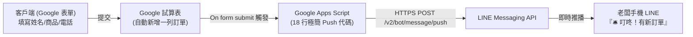

# GAS LINE Order Notification & Lightweight ERP Skill

本技能提供一套針對「零程式基礎初學者」或「中小電商賣家」的極簡化自動化方案。讓學員能在 40 分鐘內實現：**客戶填寫 Google 表單下單 ➔ Google 試算表自動存檔 ➔ 老闆手機 LINE 即時「叮咚」收到新訂單推播**。

---

## 🎯 技能適用時機 (Trigger)
* 使用者希望將 **Google 表單 (Google Forms)** 或 **Google 試算表 (Google Sheets)** 連動發送 **LINE 訂單通知**。
* 使用者需要為**零程式基礎學員**設計進銷存 (ERP) 或商業自動化教學工作坊。
* 使用者需要以 **LINE Messaging API (Push 模式)** 取代已停用的 LINE Notify。
* 使用者需要快速診斷或測試 LINE Channel Access Token 與 User ID 是否有效。

---

## 🏗️ 核心架構與運作流程



---

## 🔑 憑證準備指南（零技術門檻）

要發送 LINE 推播，只需要 2 樣憑證（**完全不需要設定 Webhook URL**）：

1. **`Channel access token (long-lived)`**：
   * 前往 [LINE Developers Console](https://developers.line.biz/) ➔ 進入 Messaging API Channel。
   * 切換至「Messaging API」分頁最下方 ➔ 點擊 **Issue** 產生長效 Token。
2. **`Your user ID`（推播收件人）**：
   * 在「Basic settings」分頁最下方 ➔ 找到 **Your user ID**（以 `U` 開頭的 33 碼字串），一鍵複製。
3. **加機器人好友**：
   * 用手機 LINE 掃描該 Channel 的 QR Code，加機器人為好友（這樣它才能把訊息傳給您）。

---

## 💻 核心代碼範本

### 1. Google 試算表端代碼 (`GoogleSheet_LineOrderNotify.gs`)
在表單關聯的 Google 試算表中，點擊 **「擴充功能」 ➔ 「Apps Script」** 貼入：

```javascript
// 請替換為您的憑證
const LINE_TOKEN = "YOUR_CHANNEL_ACCESS_TOKEN";
const MY_USER_ID = "YOUR_LINE_USER_ID"; // 以 U 開頭的 33 碼

function onFormSubmit(e) {
  const timestamp = e.values[0];
  const name = e.values[1];
  const phone = e.values[2];
  const product = e.values[3];
  const qty = e.values[4];
  const note = e.values[5] || "無";

  const message = `🛎️ 報告老闆！收到一筆新訂單！\n` +
                  `━━━━━━━━━━━━━━━\n` +
                  `👤 客戶姓名：${name}\n` +
                  `📞 聯絡電話：${phone}\n` +
                  `📦 訂購商品：${product}\n` +
                  `🔢 訂購數量：${qty} 件\n` +
                  `📝 客戶備註：${note}\n` +
                  `⏰ 下單時間：${timestamp}\n` +
                  `━━━━━━━━━━━━━━━\n` +
                  `請儘速至試算表確認出貨！✨`;

  sendLinePush(MY_USER_ID, message);
}

function sendLinePush(toUserId, text) {
  const url = "https://api.line.me/v2/bot/message/push";
  const payload = {
    to: toUserId,
    messages: [{ type: "text", text: text }]
  };

  UrlFetchApp.fetch(url, {
    method: "post",
    headers: {
      "Content-Type": "application/json",
      "Authorization": "Bearer " + LINE_TOKEN
    },
    payload: JSON.stringify(payload)
  });
}
```

### 2. 設定觸發器 (Triggers)
在 Apps Script 左側點選 ⏰「觸發條件」➔「新增觸發條件」：
* 執行功能：`onFormSubmit`
* 活動來源：`來自試算表`
* 活動類型：`提交表單時` ➔ 儲存授權。

---

## 🛠️ 輔助工具箱 (Scripts)

本技能提供以下本機輔助工具：
* **`scripts/test_line_push.py`**：1 秒測試驗證 Token 與 User ID 是否能正常送達手機。
* **`scripts/app.py`**：免 Google 帳號的本機下單網頁伺服器（Port 8888），點擊按鈕直接觸發 LINE 推播並寫入本機 CSV。
